<div align="center">

# 🎭 Act Skill · Performance Skill

### Turn "the character is very sad" into a performance a video model can actually shoot

**Emotional cause and effect · Micro-expressions · Body action · Breath and pauses · Dialogue rhythm · Camera that serves emotion**


An AI video prompt skill in which **the actor's performance dominates**.

[What it solves](#-what-it-solves) · [Core method](#-core-method) · [Quick start](#-quick-start) · [Knowledge base](#-an-extensible-emotion-knowledge-base) · [Project structure](#%EF%B8%8F-project-structure)

</div>

> This is an English translation of [yuyolin/act-skill](https://github.com/yuyolin/act-skill), with an added MiniMax H3 adapter. The original is written in Chinese.

---

## ✨ What it solves

Most AI video prompts are full of image-quality, camera and set words, and give the actor a single line:

> She is very sad, her eyes full of tears.

That is not acting direction, only an emotion label. The model does not know **when the sadness starts, what the character is holding back, what the body does first, whether tears should appear, or why the camera moves.**

The `Performance Skill` translates it into executable beats:

> When she hears the trigger line, she still finishes half of what her hands are doing, without looking up; her jaw tightens for just a moment, and her breath catches before the next line. She tries to keep a normal pace, but an extra pause slips in after the key word. The camera holds still until the first leak of emotion, then moves in slowly and stops where her eyes can still be read. No tears before the trigger.

The core difference:

| A typical prompt | The Performance Skill |
|---|---|
| Names the emotion | Writes the chain of cause and effect behind it |
| Lists expressions | Sets the order in which reactions happen |
| Makes every action happen at once | One primary carrier + one supporting carrier |
| Moves the camera for a "cinematic feel" | Moves the camera because of a trigger or a relationship |
| Piles on background and parameters | Keeps supporting information subordinate to the actor |
| Describes only the result | Also sets the emotional residue at the end and the forbidden reactions |

## 🔥 Why it is more than a prompt template

The `Performance Skill` is a director's workflow from story to a performance that can be generated:

```mermaid
flowchart LR
    A["Lock the story facts"] --> B["External goal + suppressed internal goal"]
    B --> C["Emotional curve and trigger events"]
    C --> D["Search the emotion knowledge base"]
    D --> E["Eight-dimension performance design"]
    E --> F["Dialogue, breath and silence"]
    F --> G["Camera Intent"]
    G --> H["Timeline and continuity check"]
    H --> I["Kling / Seedance 2.0 / MiniMax H3 prompt"]
```



It never pastes knowledge-base text into a prompt wholesale. The order is always: **understand the character first, then search; judge the motive first, then choose the action.** When no suitable entry exists, the skill writes its own rather than forcing a template.

## 🧠 Core method

### 1. The performance dominates

Default information budget for a prompt:

| Content | Share |
|---|---:|
| Emotion and the actor's performance | **60%-70%** |
| Dialogue, sound, breath and pauses | 10%-15% |
| Camera position, framing and movement | 10%-15% |
| Character, environment, prop and lighting continuity | 5%-8% |
| Model parameters and image-quality words | 3%-5% |

Background consistency, character consistency and camera information are all checked, but only the most necessary anchors are kept, and none of them may take over.

### 2. The eight-dimension performance framework

For each key beat, decide in order:

1. Time and shot
2. External goal and suppressed internal goal
3. Where the emotion starts, what triggers it, how it changes and where it ends
4. The trigger event and the carrier of the performance
5. Facial actions a viewer can actually see
6. Gaze, body, weight and whether the action is completed
7. Sound, breath, pauses, cutting in and silence
8. The residue at the end, and the reactions that must not happen too early

### 3. Camera Intent: the camera is "acting" too

The camera's position, stillness and movement must answer:

> What does the audience need to feel at this moment, so why is the camera here, and why does it move or not move?

- Stillness can express pressure, waiting, awkwardness or having nowhere to escape.
- Movement must be started by a trigger, a change in the relationship, a reveal of information or a character's action.
- A push-in needs its trigger, path, speed, duration and stopping point written down.
- No mechanical formulas such as "sadness always pushes in, anger is always handheld".

### 4. Dialogue is not subtitles, it is a performance event

The skill distinguishes:

- who is speaking, and whom the camera is looking at
- which word triggers the listener's reaction
- where off-screen voices, phone calls and voices behind doors come from
- who interrupts whom, and what unfinished reaction the interrupted person is left with
- when there is no dialogue, which sound, object or look carries the trigger

## 🚀 Quick start

### Calling it

```text
Use the Performance Skill.

Model: Seedance 2.0
Total duration: 12 seconds
Relationship: a couple who have just broken up
Scene: a kitchen late at night
Story: after listening to the other person's last voice message, she tries to act as if nothing is wrong
Dialogue: "Fine. I understand."
Core emotion: delayed, restrained sadness
Must keep: she is holding a cup the whole time
Must not happen: tears before the trigger, exaggerated trembling, unmotivated camera moves
```

You can call it with incomplete information. The skill uses conservative assumptions that are easy to roll back, and only asks when something missing would change the facts of the story.

### Installing

Copy or link the skill folder into your agent's skills directory:

```text
skills/direct-ai-actor-performance
```

By default the knowledge base is found inside the repository at:

```text
knowledge-base/emotion
```

You can also point to a custom knowledge base with an environment variable:

```powershell
$env:ACT_SKILL_KB="D:\your-path\knowledge-base\emotion"
```

## 📚 An extensible emotion knowledge base

The repository keeps two formats:

- [`emotion-performance-kb-v1.md`](knowledge-base/emotion/emotion-performance-kb-v1.md): easy to read, compare and collaborate on in GitHub. This is the source the search script reads.
- [`emotion-performance-kb-v1.docx`](knowledge-base/emotion/emotion-performance-kb-v1.docx): a Word version generated from the Markdown.

The current entries cover:

- Sadness: restraint, delayed reaction and the edge of breaking
- Anger: suppression, defence and short outbursts
- Fear: freezing, scanning and survival response
- Shame: making yourself smaller and avoiding being seen
- Guilt: self-blame, repair and not daring to come close
- Longing and loss: triggered by everyday objects
- Joy and relief: released only after confirmation
- Jealousy and insecurity: watching, comparing and covering up

Every qualifying entry must include: when it applies, the dual goals, a clear trigger, emotional stages, facial, body and voice evidence, the residue at the end, forbidden reactions, brief camera support and prompt fragments ready to use.

Search example:

```powershell
python skills/direct-ai-actor-performance/scripts/search_emotion_library.py `
  --query "sadness restrained delayed does not want to be seen" `
  --top-k 5 `
  --json
```

## 🎬 Kling, Seedance 2.0 and MiniMax H3

The skill first writes a platform-independent **performance master**, then makes the smallest model adaptation:

| Target | Output strategy |
|---|---|
| Seedance 2.0 | A clear multi-shot timeline; states what each reference (image, motion video, audio) is for |
| Kling | A conservative single prompt when the version's abilities are unknown; custom multi-shot or element references only once they are confirmed |
| MiniMax H3 | The master poured into H3's own format (the three-field brief, the first-frame line, or the six-section reference brief), with `<d>` dialogue tags, lips closing as an event after each line, voice references in speaking order, and a tested fix for oily skin in hard light |

Changes in model abilities do not affect the core performance logic. The repository never describes a new feature of one platform as something every version has.

## 🧪 Timeline validation

The repository includes a script that checks dialogue length and shot beats:

```powershell
python skills/direct-ai-actor-performance/scripts/validate_timeline.py examples/timeline.json
```

It checks:

- overlapping beats or unexplained gaps
- wrong start and end times, and beats outside the total duration
- whether the estimated dialogue time exceeds the time available
- whether enough time is reserved for the action

## 🗂️ Project structure

```text
act-skill/
├─ skills/
│  └─ direct-ai-actor-performance/
│     ├─ SKILL.md
│     ├─ agents/openai.yaml
│     ├─ references/
│     └─ scripts/
├─ knowledge-base/
│  └─ emotion/
│     ├─ emotion-performance-kb-v1.md
│     └─ emotion-performance-kb-v1.docx
├─ applications/performance-skill/
│  ├─ validation/
│  └─ final-acceptance.md
├─ examples/
├─ docs/
├─ registry/skills.json
├─ CHANGELOG.md
└─ README.md
```

## ✅ Quality boundaries

Before delivery, confirm that:

- every change of emotion is triggered by a clear event rather than switching out of nowhere
- every abstract emotion has at least one piece of visible or audible evidence
- expression, breath, body and voice happen in sequence rather than piling up at once
- dialogue ownership, off-screen voices, interruptions and reaction targets are clear
- the time holds the dialogue, pauses and action
- camera moves have a trigger and a stopping point, and do not steal the actor's reactions
- continuity information is brief and subordinate to the performance
- anything added only completes the execution and never rewrites the facts of the story

## 🧭 Roadmap

- `v1.x`: more emotion entries, examples and better search quality.
- `v2.x`: knowledge bases for character relationships, performance intensity and long-take beats.
- Later: feeding back real generation results, classifying failures, regression tests across models.

See [`CHANGELOG.md`](CHANGELOG.md).

## 🤝 Contributing emotion material

Observations of film performance, micro-expression notes, vocal rhythm, body behaviour, successful prompts and failure cases are all welcome. Material is not piled into the knowledge base as is; it goes through:

**Source attribution -> de-duplication -> conditions of use -> made executable -> forbidden reactions added -> search test**

Please read [`docs/knowledge-base-guide.md`](docs/knowledge-base-guide.md) first.

## 📄 License

This project uses the [MIT License](LICENSE). You may use, modify and redistribute it, but must keep the copyright and license notice.

---

<div align="center">

**A real performance prompt does not tell the character to "be sad".**  
**It lets the emotion happen at the right moment, through the right physical evidence.**

</div>
